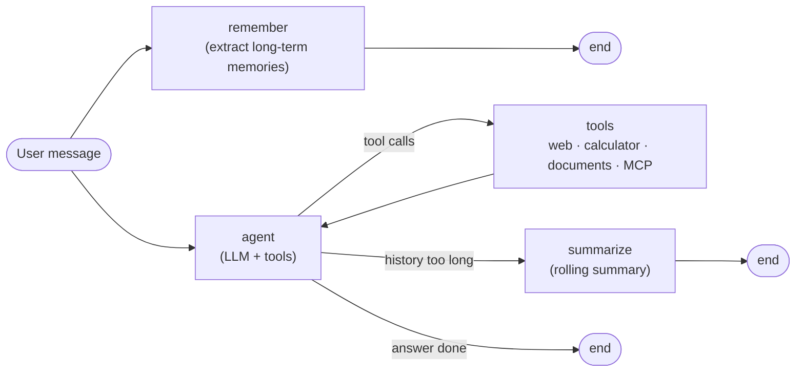
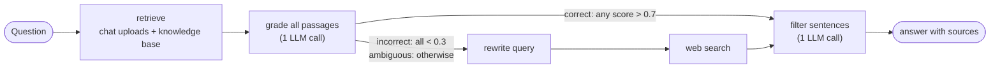

# Nexus: an AI research assistant with memory and self-correcting retrieval


Nexus is a full-stack LLM application built on **LangGraph**. A tool-calling agent answers questions
with web search, an exact calculator and your own documents. Document answers go through
**Corrective RAG**: every retrieved passage is graded, weak retrieval triggers a rewritten web search,
and the context is filtered sentence by sentence before the answer is written. Nexus keeps each
conversation's history, learns lasting facts about the user across chats, and traces every step in
**LangSmith**.

It runs locally on SQLite with zero setup, or on PostgreSQL for hosted deployments, and works with
Gemini or OpenAI by changing one environment variable.

---

## Contents

- [Highlights](#highlights)
- [Architecture](#architecture)
- [Engineering decisions](#engineering-decisions)
- [Tech stack](#tech-stack)
- [Getting started](#getting-started)
- [Configuration](#configuration)
- [Deploying to Streamlit Community Cloud](#deploying-to-streamlit-community-cloud)
- [Testing](#testing)
- [Project structure](#project-structure)
- [Roadmap](#roadmap)

---

## Highlights

**Agent and tools**
- LangGraph agent with a tool loop: web search (Tavily, with DuckDuckGo as a keyless fallback), a safe
  AST-based calculator, document search, date/time, and optional stock-price and weather tools.
- **MCP integration**: load any Model Context Protocol server (stdio or streamable HTTP) from a JSON
  config. Async MCP tools run on a background event loop behind sync wrappers.
- Token-by-token streaming with live tool status ("Searching your documents…") and an expandable trace
  of every tool call and result.

**Corrective RAG** ([Yan et al., 2024](https://arxiv.org/abs/2401.15884))
- An LLM grader scores each retrieved passage from 0 to 1 and routes the query three ways:
  **correct** (use the documents), **incorrect** (rewrite the query and search the web) or
  **ambiguous** (combine both).
- Sentence-level refinement: the context is split into sentences, irrelevant ones are dropped, and the
  rest are recombined, so the model answers from evidence only.
- Grading and filtering are **batched into single model calls**: a retrieval costs about 2 to 4 LLM
  calls in total, however many passages and sentences it finds.
- A **Retrieval inspector** page shows the verdict, each passage's score, the rewritten web query and
  which sentences were kept.

**Memory**
- *Short-term*: per-conversation history in a LangGraph checkpointer, trimmed to a token budget before
  every call and condensed into a rolling summary once it grows long.
- *Long-term*: facts the user shares ("I'm a data scientist", "I prefer concise answers") are
  extracted, de-duplicated and stored per user, then used to personalize every future conversation.
- Optional semantic recall over embedded memories, and a Memory page to view, add and delete them.

**Documents**
- Upload PDF, TXT or Markdown to a chat, or build a shared knowledge base searched by every chat.
- FAISS indexes are cached on disk under a fingerprint of the file content, chunk settings and
  embedding model, so re-uploading a file is instant and changing a setting rebuilds only what's needed.

**Production concerns**
- Provider-agnostic models via `init_chat_model`: Gemini, OpenAI or any LangChain-supported provider.
- SQLite or PostgreSQL for checkpoints, memories and the conversation list.
- LangSmith run names, tags and metadata on every chain and graph.
- Secrets from `.env` or Streamlit secrets, an optional password gate, and pinned dependencies.
- A custom-themed, five-page Streamlit interface with keyboard-focus styles, reduced-motion support and
  a mobile layout.

---

## Architecture

### Agent graph



The memory-extraction branch runs **in parallel** with the agent, so learning about the user adds no
latency to the reply. State is checkpointed per conversation; long-term memories live in a separate
per-user store shared by all conversations.

### Corrective RAG subgraph



Inside a chat, `search_documents` runs this subgraph and hands the refined context and sources back to
the agent, which writes the final answer in the flow of the conversation.

---

## Engineering decisions

**Batch the graders instead of looping over them.** The textbook CRAG loop calls the model once per
passage and once per sentence, about 20 calls for a single question. Nexus grades every passage in one
structured-output call and filters every sentence in another. That cut cost and latency, and made
the app usable on rate-limited free tiers. If a model returns a malformed batch, it falls back to
per-item calls run in parallel. A test asserts the call count stays constant as documents grow.

**Never split a tool call from its result.** When old messages are summarized away, the cut point
always moves to a user message. Removing an assistant tool call while keeping its tool result (or the
reverse) makes providers reject the whole request.

**Read the thread ID from the run config, not from the model.** Document search needs to know which
chat it's in. Rather than asking the LLM to pass `thread_id` as an argument, which it can get wrong,
the tool reads it from the injected `RunnableConfig`.

**Keep the graph synchronous and isolate async.** MCP tools are async-only, while Streamlit and the
SQLite checkpointer are synchronous. MCP calls are executed on one long-lived background event loop
behind sync wrappers, so the rest of the system stays simple.

**One storage abstraction for everything that must persist.** Conversation titles, attached documents
and long-term memories all live in the LangGraph store, so switching from SQLite to Postgres is a
single environment variable and nothing is left on an ephemeral disk.

**Evaluate arithmetic with an AST whitelist, not `eval`.** The calculator parses expressions and
allows only numeric literals, arithmetic operators and a fixed set of math functions, with an exponent
cap.

**Normalize model output at the edges.** Some providers (Gemini 3, Anthropic) return replies as lists
of content blocks rather than strings. A single helper extracts plain text wherever output reaches the
user, and a regression test covers it.

---

## Tech stack

| Layer | Technology |
|---|---|
| Orchestration | LangGraph (state graphs, checkpointers, store, `ToolNode`) |
| LLM framework | LangChain (`init_chat_model`, structured output, LCEL) |
| Models | Google Gemini or OpenAI, swappable via config |
| Retrieval | FAISS, pypdf, recursive text splitting |
| Web search | Tavily, DuckDuckGo (`ddgs`) |
| Tools protocol | Model Context Protocol (`langchain-mcp-adapters`) |
| Persistence | SQLite (local) or PostgreSQL (hosted) |
| Observability | LangSmith |
| Interface | Streamlit (custom theme, multipage), plus a CLI |
| Testing | pytest with a scripted fake LLM and deterministic embeddings |

---

## Getting started

**Requirements:** Python 3.11 and an API key for Gemini (free tier at
[aistudio.google.com](https://aistudio.google.com)) or OpenAI.

```bash
git clone https://github.com/shivakhanna10/nexus-assistant.git
cd nexus-assistant
python -m venv .venv
# Windows: .venv\Scripts\activate    macOS/Linux: source .venv/bin/activate
pip install -r requirements.txt
cp .env.example .env               # Windows: copy .env.example .env
```

Add your key to `.env`. For Gemini:

```env
GOOGLE_API_KEY=your-key
CHAT_MODEL=google_genai:gemini-3.5-flash
UTILITY_MODEL=google_genai:gemini-3.5-flash-lite
EMBEDDING_MODEL=google_genai:gemini-embedding-001
```

Run it from the project folder (so the theme in `.streamlit/config.toml` is applied):

```bash
streamlit run app.py
```

### Command line

```bash
python cli.py chat --user demo                        # streaming chat in the terminal
python cli.py index                                   # index files in data/knowledge
python cli.py crag "Batch norm vs layer norm"         # run Corrective RAG and print each decision
python cli.py essay my_essay.txt                      # parallel essay evaluation
python cli.py report "Unemployment in India"          # report, then a key-point summary
```

---

## Configuration

Everything is set through environment variables (`.env` locally, Secrets on Streamlit Cloud).
See `.env.example` for the full list.

| Variable | Purpose | Default |
|---|---|---|
| `CHAT_MODEL` | Model that talks to the user | `openai:gpt-4o-mini` |
| `UTILITY_MODEL` | Graders, query rewriting, memory extraction, titles | `openai:gpt-4o-mini` |
| `EMBEDDING_MODEL` | Document and memory embeddings | `text-embedding-3-small` |
| `POSTGRES_URI` | Use PostgreSQL instead of SQLite | empty (SQLite) |
| `TAVILY_API_KEY` | Better web search | empty (DuckDuckGo) |
| `CRAG_UPPER_THRESHOLD` / `CRAG_LOWER_THRESHOLD` | Passage-score cut-offs for the CRAG verdict | `0.7` / `0.3` |
| `CRAG_REFINE` | Sentence-level filtering | `true` |
| `MAX_CONTEXT_TOKENS` | History budget per model call | `6000` |
| `SUMMARIZE_AFTER_MESSAGES` | When to fold history into a summary | `24` |
| `LONG_TERM_MEMORY` / `SEMANTIC_MEMORY` | Cross-chat memory, and embedding-based recall | `true` / `false` |
| `LANGSMITH_TRACING` | Send traces to LangSmith | `false` |
| `APP_PASSWORD` | Require a password to open the app | empty (off) |

Optional extras:
- **Knowledge base:** put PDFs in `data/knowledge/` and click *Index* on the Knowledge base page, or
  run `python cli.py index`.
- **MCP servers:** copy `mcp_servers.example.json` to `mcp_servers.json` and add your servers.
- **Postgres locally:** `docker compose up -d`, then set `POSTGRES_URI`.

> **Tip for Gemini's free tier:** keep `UTILITY_MODEL` on a different model from `CHAT_MODEL` (for
> example Flash-Lite). Each model has its own daily quota, so background work doesn't eat into chat.

---

## Deploying to Streamlit Community Cloud

1. Push the repository to GitHub (a private repository is recommended).
2. At [share.streamlit.io](https://share.streamlit.io), create an app from the repo with main file
   `app.py` and Python 3.11.
3. Paste your settings into **Secrets**, using `.streamlit/secrets.example.toml` as the template.

Hosting notes:
- The cloud disk is wiped on restarts. Set `POSTGRES_URI` (a free [Neon](https://neon.tech) database
  works) so conversations and memories persist. Uploaded documents must be re-uploaded after a restart.
- There are no user accounts, so keep the app private in Streamlit's sharing settings or set
  `APP_PASSWORD`.
- Cloud servers are often blocked by DuckDuckGo; set `TAVILY_API_KEY` for reliable web search.
- Local `stdio` MCP servers can't run there; HTTP MCP servers can.

---

## Testing

```bash
python -m pytest -q tests
```

The suite runs fully offline in a few seconds. A scripted fake chat model supports tool calling and
structured output, so the real graphs run end to end without an API key. It covers:

- streaming, persistence, auto-titles and conversation deletion
- the tool loop
- long-term memory across conversations, including duplicate skipping and the opt-out
- summarization that keeps tool calls and results paired
- index caching
- all three CRAG verdicts, including empty retrieval
- a constant number of grader calls
- document search scoped to the current chat
- knowledge-base indexing
- content-block replies rendered as plain text
- the parallel essay evaluator

The PostgreSQL path (checkpointer, store and conversation list) was also verified end to end against a
real Postgres instance.

---

## Project structure

```
nexus-assistant/
├── app.py                  Streamlit entry point: theme, secrets, password gate, navigation
├── cli.py                  Terminal interface
├── nexus/
│   ├── agent.py            Main LangGraph agent (tools, memory, summarization)
│   ├── memory.py           Token trimming, rolling summaries, long-term memory extraction
│   ├── tools.py            Built-in tools, including the AST calculator and CRAG document search
│   ├── mcp_tools.py        MCP server loading with sync wrappers
│   ├── async_runner.py     Background event loop for async tools
│   ├── rag/
│   │   ├── indexing.py     Load, split, embed, FAISS; fingerprint-keyed index cache
│   │   └── crag.py         Corrective RAG graph with batched grading and filtering
│   ├── workflows.py        Parallel essay evaluator, report-to-summary chain
│   ├── service.py          Streaming events, history, auto-titles, status
│   ├── threads.py          Conversation registry in the LangGraph store
│   ├── persistence.py      SQLite or PostgreSQL checkpointer and store
│   ├── llm.py              Model and embedding factories, output normalization
│   ├── web.py              Tavily / DuckDuckGo search
│   └── config.py           Settings from environment variables
├── ui/                     Streamlit pages and theme
├── tests/                  Offline test suite
├── .streamlit/             Theme and secrets template
├── requirements.txt        Pinned, tested dependencies
└── docker-compose.yml      Optional local PostgreSQL (pgvector)
```

---

## Roadmap

- **RAG evaluation:** a labelled question set scored with LangSmith evaluations, to measure answer
  faithfulness and retrieval quality instead of judging them by eye.
- **User accounts:** OIDC sign-in (for example with `st.login`) so profiles become real per-user data.
- **CI:** run the test suite on every push with GitHub Actions.
- **Durable document storage:** keep uploaded files and indexes in object storage so they survive
  restarts on ephemeral hosts.
